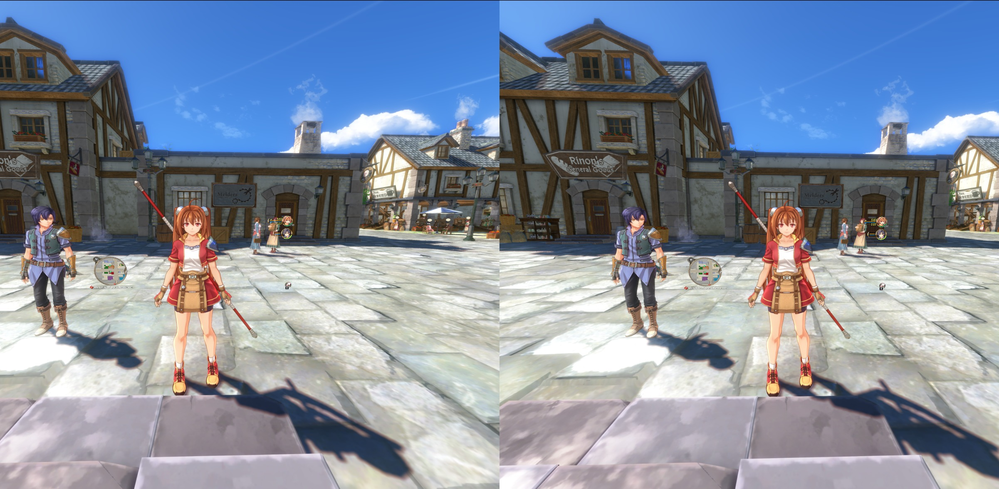
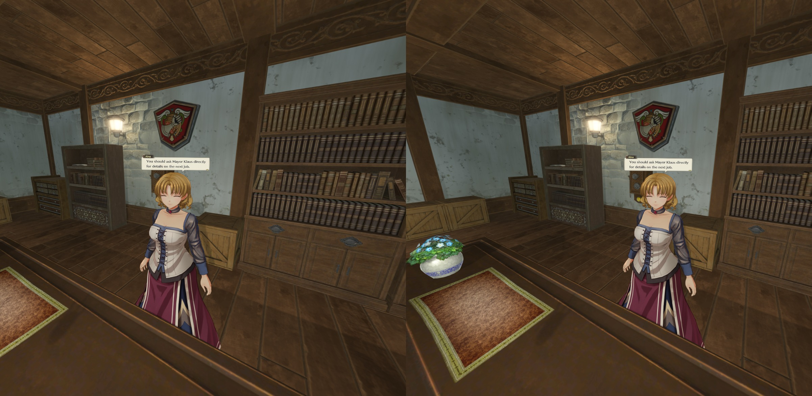
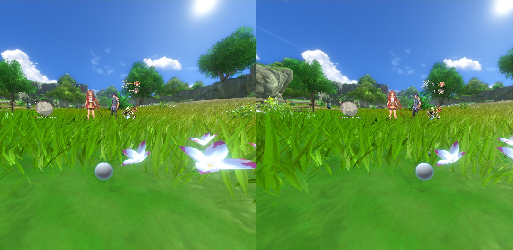
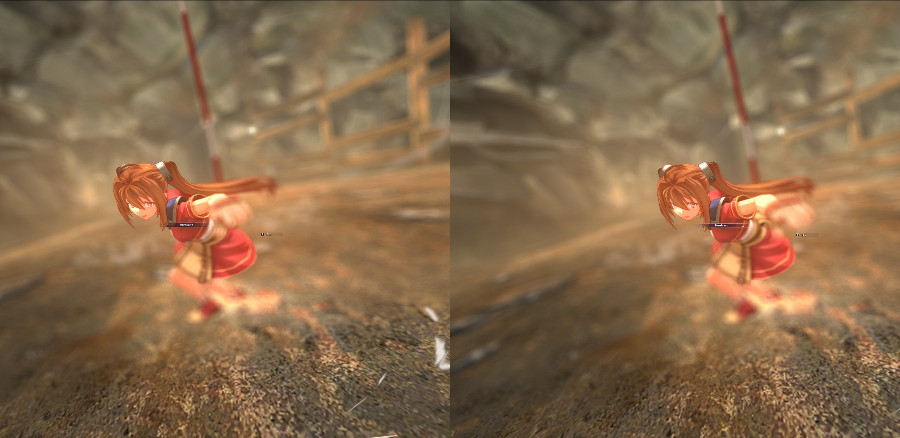

# SoraVR – VR for *Trails in the Sky 1st Chapter*

SoraVR turns the PC version of *Trails in the Sky 1st Chapter* into a seated VR game:

- **Real stereo 3D** with full head tracking (6DOF). Both eyes are rendered every frame from their own position. This is a real VR camera, not a side-by-side picture shown in a headset.
- **Depth-corrected world elements**: floating labels, item markers, speech icons and waypoints sit at their real place in the 3D world instead of floating in front of you.
- **Toon outlines corrected on the fly**: they keep the right thickness when the field of view changes.
- **Automatic wide field of view**: SoraVR finds the game's camera field of view by itself on every start and sets it to a VR-friendly value (90° by default, `GameFov` in the ini, F2/F3 to adjust). It remembers where it found it, so later starts are instant. The field of view is also locked, so camera zooms in cutscenes don't change it.
- **The game's interface on a floating panel**: menus, dialogue and map, with the mouse cursor visible on it.
- **VR controllers as a pointer** for the panel (click and drag), shown as small glowing orbs.
- **Controllers interact with the world**: hair, cloth, ribbons and accessories move out of the way when you touch them.
- **Menus show the live 3D world** behind them, blurred and darkened like the game's own menus, and 3D models in menus have depth.

You still play with mouse/keyboard or a gamepad. The controllers are for pointing at the panel and touching things.

## Screenshots

Captured in the headset, both eyes side by side as **cross-eye** pairs: cross your eyes until the two pictures merge into a third one in the middle, and it shows in 3D. Versions for parallel viewing (left eye on the left) are in [`docs/screenshots`](docs/screenshots).

| | |
|---|---|
|  |  |
| Town square | Dialogue, labels sit in the world |
|  |  |
| In the field, with a controller orb | Battle |

---

## 1. What you need

| | |
|---|---|
| Game | *Trails in the Sky 1st Chapter* for PC (Steam), tested with versions **1.06.1** and **1.07**, started from Steam or from the game folder. SoraVR finds the game code it needs by itself, so small updates usually keep working; if it doesn't recognise something, it switches only that feature off and says so in the log. *Trails in the Sky 2nd Chapter* (demo): **experimental**. It starts and shows in VR, but with the simpler alternate-eye mode, no hair physics and no live world behind menus. Full support is planned. |
| VR | A PC VR headset with an **OpenXR** runtime. Tested: Windows Mixed Reality headset through **SteamVR** (SteamVR as the OpenXR runtime). |
| Files | The SoraVR zip: `d3d11.dll` (SoraVR), `openxr_loader.dll` (the official Khronos OpenXR loader, Apache 2.0) and a `SoraVR` folder with this README, the licences, the changelog and the default settings. |
| PC | A strong GPU. Both eyes are rendered every frame, so expect roughly half your normal frame rate. Lower the game's render scale if it's too slow. |

## 2. Install

1. Find the game folder: the folder that contains **`sora_1st.exe`**. (Steam: right-click the game → *Manage* → *Browse local files*, then into the `game` folder.)
2. Extract the zip into that folder, so that `d3d11.dll` and `openxr_loader.dll` sit next to `sora_1st.exe`. (The `SoraVR` folder only holds documentation and can go anywhere.)
3. Start SteamVR (or your OpenXR runtime), then start the game, from Steam or from the folder. SoraVR creates `SoraVR.ini` with all settings the first time it runs.
4. **Upgrading from SkyStereo** (the old name of this mod): just replace `d3d11.dll`. Your `SkyStereo.ini` is renamed to `SoraVR.ini` automatically, so your settings are kept. The old `SkyStereo.log` can be deleted.
5. If another d3d11 mod is in that folder (for example FDK_vr or 3DMigoto), remove it first. Only one `d3d11.dll` can be used.

**Uninstall:** delete `d3d11.dll`, `openxr_loader.dll`, `SoraVR.ini`, `SoraVR.log` and the `SoraVR` folder from the game folder.

## 3. Recommended game settings

In the game's graphics options:
- **Volumetric lighting: off.** The light shafts don't line up between the eyes.
- **DLSS / FSR: off** (game 1.07+). They reuse the previous frame, and SoraVR renders the eyes one after the other, so leftovers of one eye's picture stay visible in the other.
- **Anti-aliasing / TAA: off** is recommended (sharper in the headset).
- **Render scale:** as high as your PC allows (tested at 200%). Lower it if the frame rate is too low.

## 4. First start

1. **Start SteamVR first** (or your OpenXR runtime) and put the headset on, or keep it nearby.
2. Start the game from Steam.
3. Sit how you want to play. About **3 seconds** after the headset starts tracking, SoraVR **recenters** automatically. Press **F1** any time to recenter again.
4. The game's interface appears as a floating panel in front of you. Use **PgUp / PgDn** to move it nearer or farther, **Home / End** to make it bigger or smaller.
5. The first time, SoraVR searches for the game's field-of-view setting by itself, and the view may flicker for a moment while it tests candidates. It remembers what it found, so later starts set the field of view right away. This is automatic (`AutoFov=1`); you don't need to do anything.

If the headset only shows a grey or loading screen, see *Troubleshooting* below.

## 5. Controls

### VR controllers
- **Point at the panel** while the game shows a mouse cursor: the cursor follows a light-blue beam.
  - **Trigger** = left click, **grip** = right click. **Hold and move** to drag (for example to turn 3D models in menus).
  - The pointer only works while the game shows a cursor and its window has focus, so it never turns the camera.
- Each controller is shown as a **small glowing orb**. It fades out when you hold the controller still, and comes back when you move it.
- **Touch hair, cloth or ribbons** with a controller and they move aside. Bodies are never pushed; the orb just shows through them.

### Keyboard

| Key | Action |
|---|---|
| **F1** | Recenter the view |
| **F2 / F3** | Field of view narrower / wider (saved) |
| **F4** | Head tracking off / on (for this session) |
| **F5** | Level horizon on / off |
| **F6** | Swap left and right eye (if the 3D ever looks inside-out) (saved) |
| **F7 / F8** | World scale smaller / bigger: how big the world feels (saved) |
| **F9** | Dual render on / off (off = older, faster alternate-eye mode) |
| **F10** | Stereo 3D on / off |
| **F12** | Field-of-view lock on / off (on at every start; set `FovLock` in the ini to change that) |
| **Insert** | Floating panel on / off |
| **Delete** | Panel stays in the room / follows your head (saved) |
| **PgUp / PgDn** | Panel nearer / farther (saved) |
| **Home / End** | Panel bigger / smaller (saved) |
| **Ctrl+F10** | Live 3D world behind menus on / off |
| **Ctrl+F5 / Ctrl+F6** | Depth of 3D models in menus less / more (saved) |
| **Ctrl+F7 / Ctrl+F8** | 3D models in menus further back / closer (saved) |
| **Ctrl+Insert** | Show the controller physics spheres (orange circles) |
| **Ctrl+PgUp / Ctrl+PgDn** | Physics sphere bigger / smaller (saved) |
| **Ctrl+Home / Ctrl+End** | Physics sphere forward / back (saved) |
| **Ctrl+F12** | Search the game's field-of-view setting by hand |

Keys marked *saved* write their new value to `SoraVR.ini`. The on/off keys only last until you close the game, so the next start always uses the ini. Most keys can be changed in the `[Keys]` section of `SoraVR.ini`.

## 6. Settings

All settings are in **`SoraVR.ini`** next to `sora_1st.exe`, each with a short explanation. The ones you're most likely to change:

| Setting | Section | What it does |
|---|---|---|
| `WorldScale` | `[VR]` | How big the world feels (F7/F8). |
| `GameFov` | `[VR]` | Field of view the game renders with (F2/F3). Wider stops objects popping in at the edges. |
| `Distance`, `Width` | `[HUD]` | Panel distance and size (PgUp/PgDn, Home/End). |
| `HeadLocked` | `[HUD]` | 0 = panel stays in the room, 1 = follows your head (Delete). |
| `MenuBlur`, `MenuDim` | `[Stereo]` | Blur and darkness of the world behind menus. |
| `OrbSize`, `FadeWhenStill` | `[Controllers]` | Orb size, and whether it fades when still. |
| `Physics` | `[Controllers]` | Hair/cloth reacting to the controllers on/off. |

Hotkeys marked *saved* write their value to the ini straight away. To go back to the defaults, delete `SoraVR.ini` and start the game; a fresh one is written.

## 7. Troubleshooting

SoraVR writes **`SoraVR.log`** next to `sora_1st.exe` every time the game runs. It says what worked and what didn't. Include it when you report a problem.

| Problem | What to try |
|---|---|
| Headset stays grey / shows no game | Start SteamVR **before** the game. Check that `openxr_loader.dll` is next to `sora_1st.exe`, and that SteamVR is set as the OpenXR runtime (SteamVR settings → *OpenXR*). The log says `openxr_loader.dll not found` if it's missing. |
| The view is off to the side / too high | Sit how you play and press **F1**. |
| The 3D looks inside-out | Press **F6**. |
| The world feels too big or too small | **F7 / F8**. |
| Things pop in at the edges of the view | **F3** for a wider field of view. |
| Too slow | Lower the game's render scale, or press **F9** for the faster alternate-eye mode (less comfortable). |
| The game crashes at startup | It happened occasionally in testing; start it again. If it keeps happening, send `SoraVR.log`: its last lines show where it crashed. |
| A feature says "not recognised" in the log | Your game version changed that part of the game code. That feature stays off so nothing breaks; please report it with the log. |
| Something floats in front of you instead of sitting in the world (a label, marker or effect that follows your head) | It's drawn by a shader SoraVR doesn't correct yet. You can find it and send it in, see *Reporting a floating element* below. |

### Reporting a floating element

SoraVR has "shader hunting" keys for finding which shader draws something:

1. Turn **NumLock on** and stand where the floating element is visible.
2. Press **Numpad 2** (next) or **Numpad 1** (previous) to step through the shaders. The selected shader is hidden, so watch for the moment the floating element **disappears**. **Numpad 8 / 7** jump 10 at a time.
3. When it's gone, press **Numpad 9**. This saves a file called `SoraVR_VS_<number>.txt` next to `sora_1st.exe`.
4. Press **Numpad 0** to stop hunting (everything shows again).
5. Open an issue and attach that `.txt` file, plus `SoraVR.log`, and a short note or screenshot of what was floating and where.

## 8. Known issues

- **Volumetric lighting** (light shafts through windows, also in caves and inside buildings) doesn't match between the eyes: turn *volumetric lighting* off in the game's settings.
- **DLSS and FSR** (game 1.07+) leave ghost images of the other eye: keep them off.
- **Objects can disappear at the edges of the view in some scenes.** The game skips drawing things it thinks are off-screen, based on its own camera. In scenes where the game uses its own special camera (some cutscenes), SoraVR's wider field of view can't reach the game's visibility check, so objects near the edges of the headset view may pop in and out.
- **The title screen** is flat. It's shown as a big screen behind the menu panel, because the game doesn't render it as a 3D scene.
- **Some soft shadows look flat**, as if painted onto the picture rather than lying on the surfaces. Not distracting, but noticeable; being looked into.
- **2nd Chapter (demo)** is experimental: alternate-eye only, no hair physics, flat menu background.
- The controllers don't act as a gamepad yet (planned for v1.1).

## 9. Credits and licences

- SoraVR is free software: GNU General Public License v3.0 or later (`LICENSE`). Source code: https://github.com/caffeineowly/SoraVR
- SoraVR is a fan-made mod, not affiliated with the game's developers or publishers.
- OpenXR headers and loader © The Khronos Group, Apache License 2.0 (`LICENSE-OpenXR.txt`).
